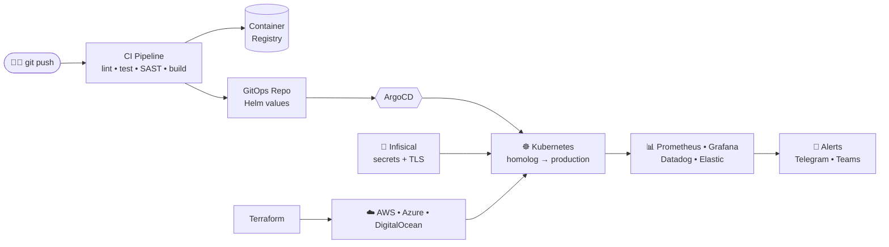

<!-- ═══════════════════════════ HEADER ═══════════════════════════ -->
<p align="center">
  
</p>

<p align="center">
  <a href="https://github.com/mouradev1">
    
  </a>
</p>

<p align="center">
  <a href="https://www.linkedin.com/in/josemouradev"></a>
  
  
  
  
</p>

---

## `$ whoami`

```yaml
apiVersion: engineer/v1
kind: DevOpsEngineer
metadata:
  name: jose-moura
  location: São Luís, MA, Brazil 🇧🇷   # working remote
  labels:
    role: devops-platform-engineer
    hybrid: backend-developer          # I ship the code AND the platform it runs on
spec:
  experience: "8+ years"
  certifications:
    - AZ-900 Microsoft Azure Fundamentals ✅
  focus:
    - Kubernetes platforms (multi-env, multi-tenant)
    - CI/CD & GitOps pipelines (GitLab CI, GitHub Actions, ArgoCD)
    - Infrastructure as Code (Terraform)
    - Observability (metrics, logs, alerts that actually matter)
    - Secrets & certificate management (Infisical, cert-manager, TLS)
    - Event-driven scaling (KEDA, ScaledJobs, batch workloads)
  backend:
    languages: [PHP 8+, Go, TypeScript, C#]
    frameworks: [Laravel, Node.js, .NET]
  mindset:
    - "If you do it twice, automate it."
    - "No dashboard, no production."
    - "Cost is a feature."
status:
  currentlyLearning: [Platform Engineering, Internal Developer Platforms, eBPF]
  openTo: [DevOps, Platform/SRE, Senior Backend (PHP/Go) roles]
```

---

## 🏗️ How I build things



---

## ⚡ Tech Stack

<table>
  <tr>
    <td align="center" width="140"><b>☁️ Cloud & IaC</b></td>
    <td> &nbsp;
      
      </td>
  </tr>
  <tr>
    <td align="center"><b>☸️ Containers</b></td>
    <td> &nbsp;
      
      </td>
  </tr>
  <tr>
    <td align="center"><b>🔄 CI/CD & GitOps</b></td>
    <td> &nbsp;
      </td>
  </tr>
  <tr>
    <td align="center"><b>📊 Observability</b></td>
    <td> &nbsp;
      </td>
  </tr>
  <tr>
    <td align="center"><b>🔐 Security</b></td>
    <td>
      
      </td>
  </tr>
  <tr>
    <td align="center"><b>💻 Backend</b></td>
    <td></td>
  </tr>
  <tr>
    <td align="center"><b>🗄️ Data</b></td>
    <td></td>
  </tr>
</table>

---

## 🚀 Featured Projects

| Project | Stack | What it does |
|---|---|---|
| ☸️ **KubeMonitor** | `Go` `Kubernetes` | Watches Kubernetes clusters and fires alerts to **Telegram** and **Microsoft Teams** — pod crashes, restarts and unhealthy workloads before users notice. |
| 📮 **Consulta de CEPs** | `Go` `Node.js` `Redis` `MongoDB` `Nginx` | Dual-implementation microservice (Go vs Node) with Redis caching, MongoDB persistence and Nginx load balancing. |
| 🔗 **[LinkBambu](https://linkbambu.com)** | `Laravel` `Docker` `CI/CD` | Bio-link platform in production with access metrics and customization — built and operated end to end. |
| 💰 **DinDin Planejado** | `Laravel 12` `TailwindCSS` | Personal finance goals platform with charts and objective planning. |

---

## 🧠 What I actually do in production

- **Kubernetes operations** — multi-environment clusters (homolog / production), Ingress + TLS, node labeling & scheduling, KEDA `ScaledJob`s for batch and report workloads.
- **Secrets done right** — Infisical Operator syncing secrets and TLS certificates straight into Kubernetes, no plaintext in repos.
- **Pipelines** — GitLab CI / GitHub Actions / Jenkins with build, tests, security scan and GitOps promotion via ArgoCD.
- **Automation & tooling** — scripts that crawl hundreds of GitLab repos to audit dependencies (e.g. Maven `pom-parent` versions) and feed upgrade plans.
- **Backend** — PHP 8+/Laravel APIs, microservices, queues and messaging; Go services and CLIs for infra.
- **FinOps** — rightsizing, autoscaling and cleaning up what nobody was using.

---

## 🎓 Certifications & Education

<p>
  
  
  
  
</p>

🎓 **Systems Analysis & Development** — Uniasselvi *(in progress)*

---

## 📈 GitHub Analytics

<p align="center">
  
  
</p>

<p align="center">
  
</p>

<p align="center">
  
</p>

---

## 📫 Let's Connect

<p align="center">
  <a href="https://www.linkedin.com/in/josemouradev"></a>
  <a href="https://github.com/mouradev1"></a>
  <a href="https://linkbambu.com"></a>
</p>

```bash
$ echo "Engineering reliable systems. Automating complexity. Building what comes next."
```

<p align="center">
  
</p>
